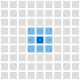
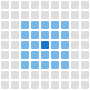
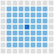

# Envision: a Color Contrast Analyzer Extension for Chrome and Firefox

This tool is based on the [Color Contrast Analyzer Extension for Google Chrome (archive link)](https://web.archive.org/web/20191019190253/https://accessibility.oit.ncsu.edu/tools/color-contrast-chrome/) created by [Greg Kraus](https://www.linkedin.com/in/gregorykraus/) of [NC State University IT Accessibility Resources](https://accessibility.ncsu.edu/).  Since it hadn't been updated for Google Chrome's Manifest v3, it seems like it was abandoned as [the original github site for that project](https://github.com/gdkraus/color-contrast-chrome).  This repositoy forked that code, updated it to support Manifest v3, and added Firefox Extension support as well.

This extension allows you to analyze text color contrast problems on a web page according to the WCAG 2 color contrast requirements.

## Why use this tool?

*   Analyze text over top of background images or gradients
*   Analyze text in images
*   Get a visual overview of the contrast of your page

## How to use the tool

1.  Go to the page to analyze.
2.  Choose to either analyze a section of the page, the visible portion of the page, or the entire page.
3.  Once the results page appears, adjust the WCAG level to evaluate a different conformance level or text size. In general,
    *   For regular-sized text, choose WCAG AA, Small Non-Bold (4.5:1). This is for text smaller than 18pt. or approximately 24 px.
    *   For larger text, like headings, choose WCAG AA, Medium-Bold and Large Non-Bold Text (3:1). This is for bold text larger than 14pt or non-bold text larger than 18pt, or approximately 18.66 px and 24 px, respectively.
4.  Also, you can adjust the pixel analysis radius to better handle anti-aliasing of text where the transition from one color to another is more gradual. Note, increasing the pixel radius will increase the computation time.
5.  Text which passes the given conformance level will be outlined in white.
6.  Toggle the mask on and off to see what elements on the underlying page lack enough contrast.

## How does it work?

Color Contrast Analyzer uses pixel-by-pixel image analysis to identify boundaries between colours that meet a specified WCAG contrast ratio. It then highlights those boundaries in a mask over the original screenshot.  To do this, it does the following:

1. Captures the webpage as an image. The tool analyses the screenshot rather than inspecting the HTML or CSS.

2. Examines neighbouring pixels. For every pixel, it compares its colour against surrounding pixels within a configurable radius (1–3 pixels):

    * Radius 1 — Fine detail: Examines immediately adjacent pixels, making it sensitive to sharp colour transitions. Useful for detecting fine outlines and crisp text edges. 
    
      

    * Radius 2 — Intermediate: Examines pixels up to two pixels away. It can detect contrast across anti-aliased edges or slightly wider transitions that Radius 1 misses.

      

    * Radius 3 — Broader detection: Examines pixels up to three pixels away. It can identify contrast across wider gradients or softened edges, but may also highlight boundaries that are less visually immediate.

      
   
   Note that choosing a higher pixel radius takes the extension longer to display the results.

3. Calculates colour contrast. It converts RGB values to relative luminance using the WCAG formula, then calculates the contrast ratio: $\frac{L_{\text{lighter}}+0.05}{L_{\text{darker}}+0.05}$

4. Identifies contrast boundaries. If a neighbouring pixel meets or exceeds the selected contrast threshold, the tool marks the current pixel as part of a contrast boundary. For example, with a 4.5:1 threshold, it identifies transitions between colours whose contrast ratio is at least 4.5:1.

5. Creates the mask. Pixels identified as contrast boundaries are assigned white or grey values, depending on the radius at which they were detected. Other pixels are black. The tool combines this mask with the original screenshot at approximately 75% mask opacity and 25% original image.

The result is a visual representation of where sufficient colour contrast exists, making it easier to spot text and other content that may lack adequate contrast.

## Important limitations

* The tool doesn't understand what constitutes text, an icon, or a UI component. It identifies colour differences between nearby pixels, not semantic elements.  Consequently, it can highlight high-contrast boundaries in photographs or decorative elements, and it cannot conclusively determine whether a webpage satisfies WCAG contrast requirements.

* The current algorithm rounds calculated contrast ratios to one decimal place before comparing them against the threshold. This can make borderline results slightly less precise.

## Things to keep in mind when using this tool

*   You must understand the size of the text you are trying to analyze, because it matters which WCAG criteria you choose.

## Tips and Tricks

*   Almost any type of file you can open in your browser, including image and PDF files, can be evaluated for text color contrast too. For PDF files you will only be able to evaluate the visible portion of the PDF. **To analyze local files you will need to go to your Extensions page and check "Allow access to file URLs" for this extension.**
*   When first installing the extension, you may need to refresh the webpage you wish to analyze for all of the selection options to be available.

Note, when installing the extension it will ask you for permission to access your data on all of your websites and your tabs and browsing activity. We are not using or collecting this data in any way. In order to get permission to take screenshots of your browser window this is the level of access we must request. You can view the [source code for the project](https://github.com/zoltan-dulac/color-contrast-chrome).

## Notes on the Code

Some of this code is from a screen capture extension from Google (which seems to have been abandoned).
The original author, Greg Kraus, used the code from that     project for creating the draggable selection box. This code has lots of other functionality, most of which was removed. There could still be some remnants of this code that is basically dormant in the Color Contrast Analyzer at this point.

## Versions

### This repository:

2.0 
* Added Google Manifest v3 support 
* Added Firefox Support
* Added support for Retina and High Density Displays.

### The original NC State University IT Accessibility Resources repository:

1.1.2
* adjusted z-index for the draggable area to the maximum allowed value of 2147483647 to help ensure it will not be positioned underneath other elements

1.1.1
* adjusted CSS for Windows buttons

1.1.0
* added ability to download the image analysis to a local file

1.03
* fixed a bug where the WCAG 2 and pixel radius settings were not sticking once you clicked the rescan button

1.02
* added better support for processing local files within Chrome

1.01
* added keyboard support for the popup window
* increased the z-index value of the draggable area

1.00
* compressed icon images and removed unused images

0.60
* fixed problem with extension not loading when the page was idle for too long
* made the layout screen more fluid
* added WCAG contrast ratio levels to the conformance level selector
* added the link to the help file

0.53
* initial commit

## Cross-browser builds

Run `python3 build.py` to generate Chrome and Firefox builds from shared source. See [CROSS-BROWSER.md](CROSS-BROWSER.md).
